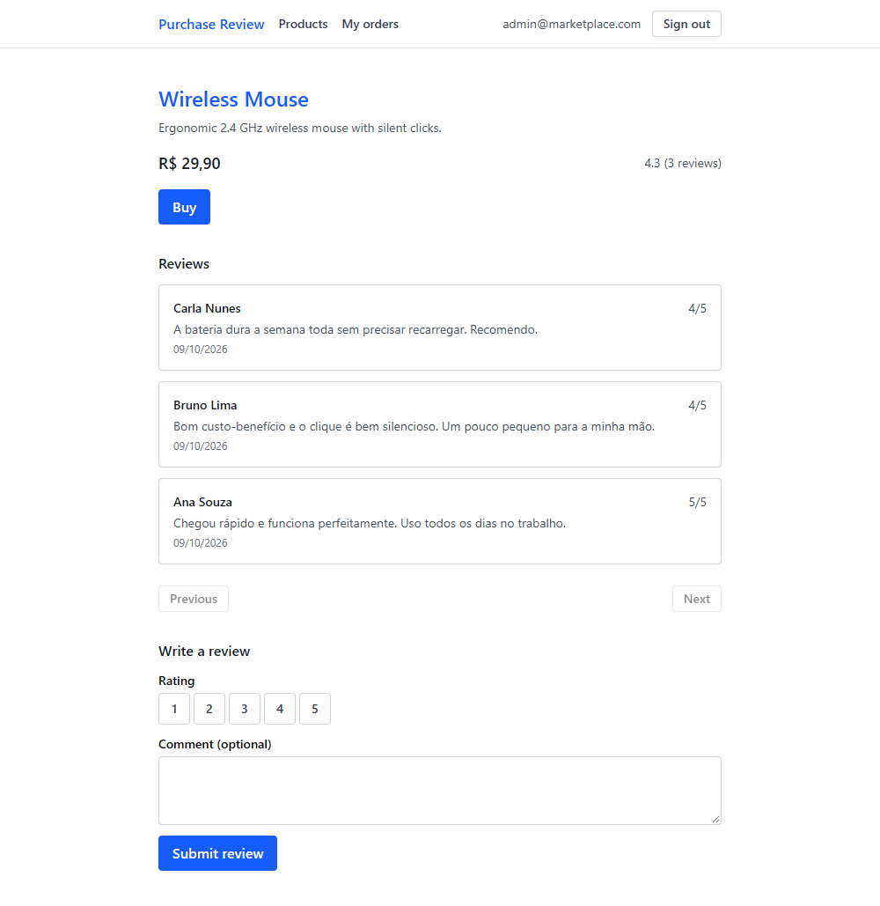

# Purchase Review Frontend

[Português](#portugues) | [English](#english)

---

## Português

Interface web em React + TypeScript para a [Purchase Verified Review API](https://github.com/MarcioRosendoF/purchase-verified-review-api), um marketplace com uma regra central: **só quem comprou um produto pode avaliá-lo**.

É o meu segundo projeto prático com React, e o degrau aqui é TypeScript + JWT juntos: login de verdade, token no header, rotas protegidas e tipos descrevendo o contrato da API.

### Funcionalidades

- Login e registro com JWT, sessão persistida no `localStorage`
- Rotas protegidas: sem token, qualquer tela cai no login — e depois de entrar o app volta para a tela que você queria
- Lista de produtos paginada, com média e quantidade de avaliações
- Detalhe do produto com a lista de reviews
- Comprar (1 unidade) e avaliar o produto comprado (nota 1–5 + comentário opcional)
- Meus pedidos, paginado
- Erros de negócio do backend exibidos como vieram; sessão inválida limpa o estado e volta ao login

### Tecnologias

- React 19 + TypeScript (`strict`, zero `any` explícito)
- Vite 8
- Tailwind CSS 4
- React Router 7
- oxlint
- GitHub Actions (CI: `npm ci` + lint + build em push e pull request)
- `fetch` nativo, sem axios

### Como rodar

1. Suba a Purchase Verified Review API na porta 8080. No repositório do backend: `docker compose up -d` (sobe o Postgres) e `./mvnw spring-boot:run` com `DB_PASSWORD` e `JWT_SECRET` definidos no ambiente
2. `npm install`
3. `npm run dev`
4. Acesse http://localhost:5173
5. Crie produtos de teste pela conta admin (`admin@marketplace.com` / `admin123`) no Swagger do backend — a UI de admin está fora de escopo

O Vite faz proxy de `/api` para `http://localhost:8080`, então o frontend chama a API com caminhos relativos, sem configurar CORS.

O prefixo `/api` não é decorativo: o app tem rotas com os mesmos caminhos da API (`/orders/my`, `/products/:id`) e o proxy do Vite casa a regra por prefixo. Sem o prefixo, um F5 ou um link direto nessas telas seria engolido pelo proxy e receberia JSON do backend no lugar do app.

### Endpoints consumidos

| Método | Rota | O que faz |
|---|---|---|
| POST | `/auth/register` | cria a conta e já devolve o token |
| POST | `/auth/login` | autentica |
| GET | `/products` | lista paginada |
| GET | `/products/{id}` | detalhe do produto |
| POST | `/orders` | compra 1 unidade |
| GET | `/orders/my` | pedidos do usuário logado, paginado |
| POST | `/reviews` | avalia um produto comprado |
| GET | `/reviews/product/{productId}` | reviews do produto |

### Idioma e formatação

Textos de interface em inglês, porque é decisão de código. Mensagens de erro do backend aparecem exatamente como vieram (pt-BR). Preço e data usam `Intl` em pt-BR (`R$ 19,90`, `28/08/2026`): locale de dado não é texto de interface.

### Limitações conhecidas

- O JWT expira em 24h e o backend não tem refresh token: expirou, faça login de novo. É decisão, não pendência
- Não dá para editar nem excluir review — o backend não tem esses endpoints
- Sem UI de admin: criar e remover produtos sai pelo Swagger do backend
- Paginação só com Anterior/Próxima (a API usa `size=10`, ordenado por `createdAt` DESC)
- A navegação vive na NavBar; o nome do app não é clicável e o detalhe não tem link de volta
- Sem deploy: o backend depende de um Postgres local via docker-compose
- Sem testes automatizados no repositório

---

## English

React + TypeScript web interface for the [Purchase Verified Review API](https://github.com/MarcioRosendoF/purchase-verified-review-api), a marketplace built around one rule: **only someone who bought a product can review it**.

This is my second hands-on React project, and the step up here is TypeScript and JWT together: real login, token in the header, protected routes and types describing the API contract.

### Features

- Login and registration with JWT, session persisted in `localStorage`
- Protected routes: with no token, every screen falls back to login — and after signing in the app returns you to the screen you wanted
- Paginated product list with average rating and review count
- Product detail with its review list
- Buy (1 unit) and review the purchased product (rating 1–5 + optional comment)
- My orders, paginated
- Backend business errors shown as they come; an invalid session clears the state and returns to login

### Tech stack

- React 19 + TypeScript (`strict`, no explicit `any`)
- Vite 8
- Tailwind CSS 4
- React Router 7
- oxlint
- GitHub Actions (CI: `npm ci` + lint + build on push and pull request)
- Native `fetch`, no axios

### How to run

1. Start the Purchase Verified Review API on port 8080. In the backend repository: `docker compose up -d` (starts Postgres) and `./mvnw spring-boot:run` with `DB_PASSWORD` and `JWT_SECRET` set in the environment
2. `npm install`
3. `npm run dev`
4. Open http://localhost:5173
5. Create test products with the admin account (`admin@marketplace.com` / `admin123`) through the backend Swagger — the admin UI is out of scope

Vite proxies `/api` to `http://localhost:8080`, so the frontend calls the API with relative paths and no CORS setup.

The `/api` prefix is not decorative: the app has routes sharing the API paths (`/orders/my`, `/products/:id`) and Vite matches proxy rules by prefix. Without it, a refresh or a direct link on those screens would be swallowed by the proxy and get JSON from the backend instead of the app.

### Consumed endpoints

| Method | Path | What it does |
|---|---|---|
| POST | `/auth/register` | creates the account and returns the token |
| POST | `/auth/login` | authenticates |
| GET | `/products` | paginated list |
| GET | `/products/{id}` | product detail |
| POST | `/orders` | buys 1 unit |
| GET | `/orders/my` | orders of the logged user, paginated |
| POST | `/reviews` | reviews a purchased product |
| GET | `/reviews/product/{productId}` | product reviews |

### Language and formatting

User interface text is in English, as a code decision. Backend error messages are shown exactly as they come (pt-BR). Price and date use `Intl` in pt-BR (`R$ 19,90`, `28/08/2026`): data locale is not interface text.

### Known limitations

- The JWT expires in 24h and the backend has no refresh token: once it expires, sign in again. A decision, not a pending task
- Reviews cannot be edited or deleted — the backend has no such endpoints
- No admin UI: creating and deleting products goes through the backend Swagger
- Pagination is Previous/Next only (the API uses `size=10`, sorted by `createdAt` DESC)
- Navigation lives in the NavBar; the app name is not clickable and the detail page has no back link
- No deploy: the backend depends on a local Postgres through docker-compose
- No automated tests in the repository

---

Developed by [Marcio](https://github.com/MarcioRosendoF)
